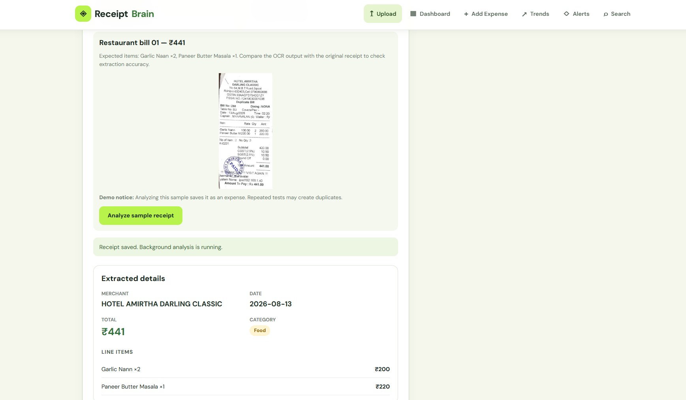
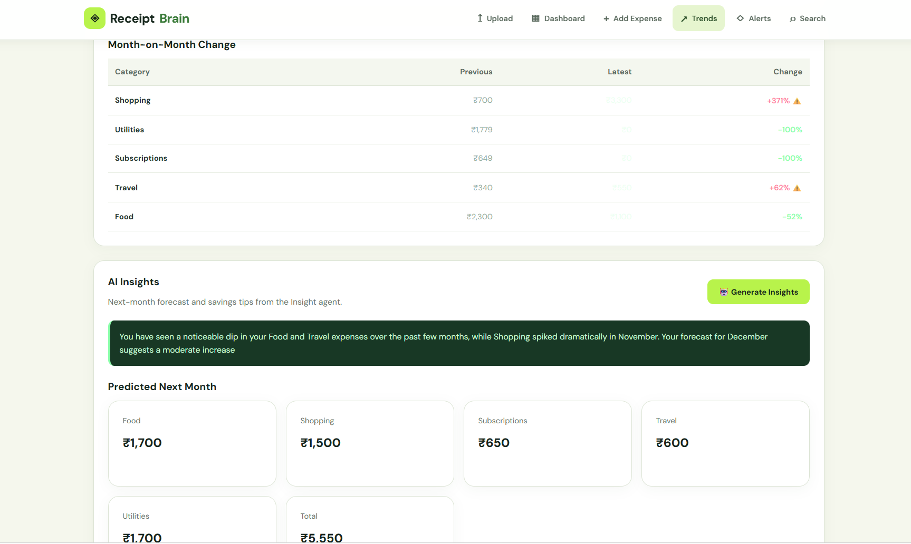
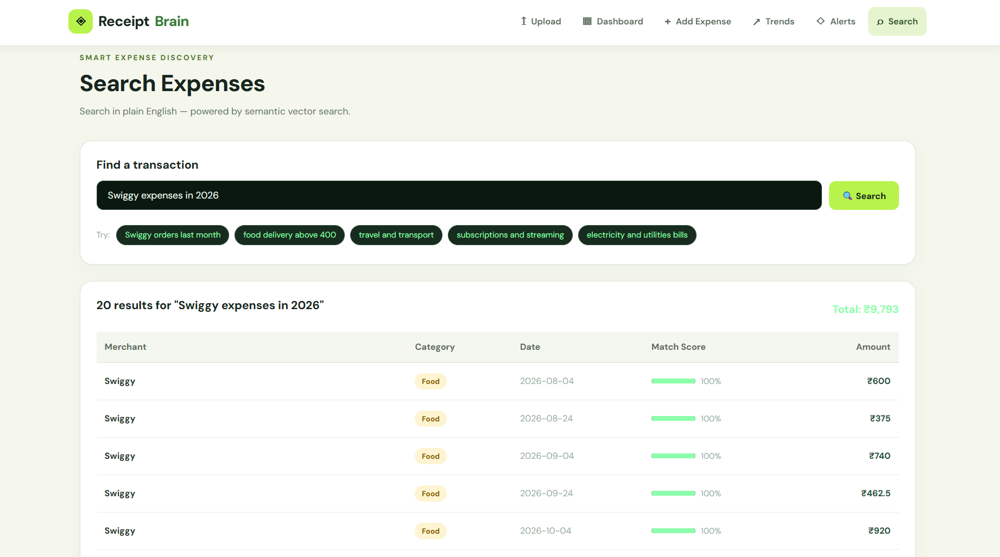
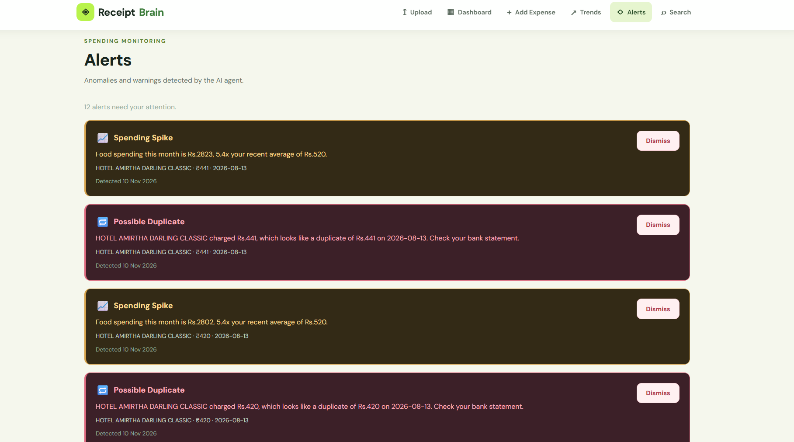
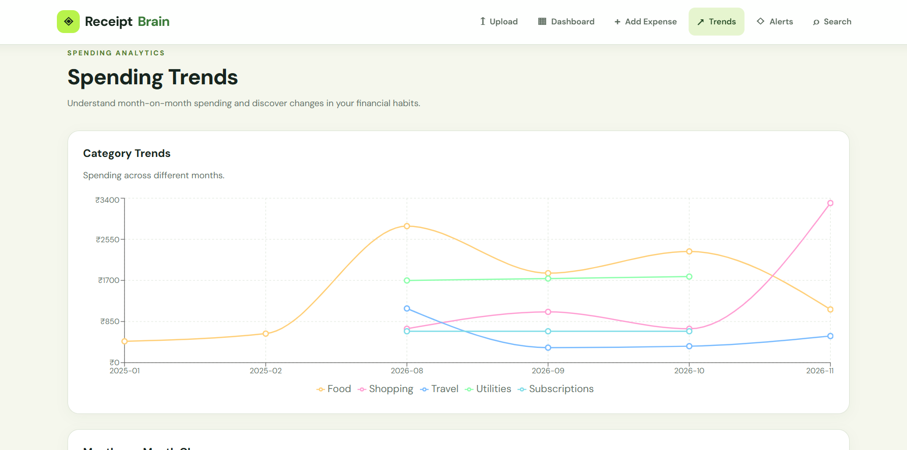
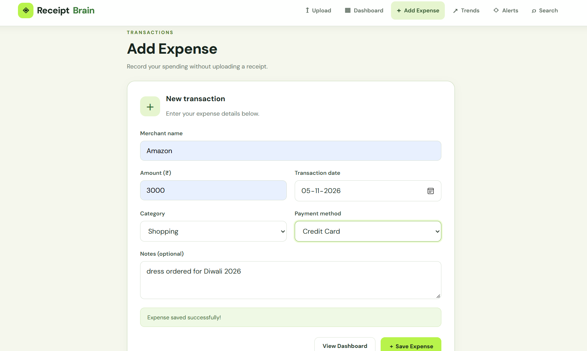
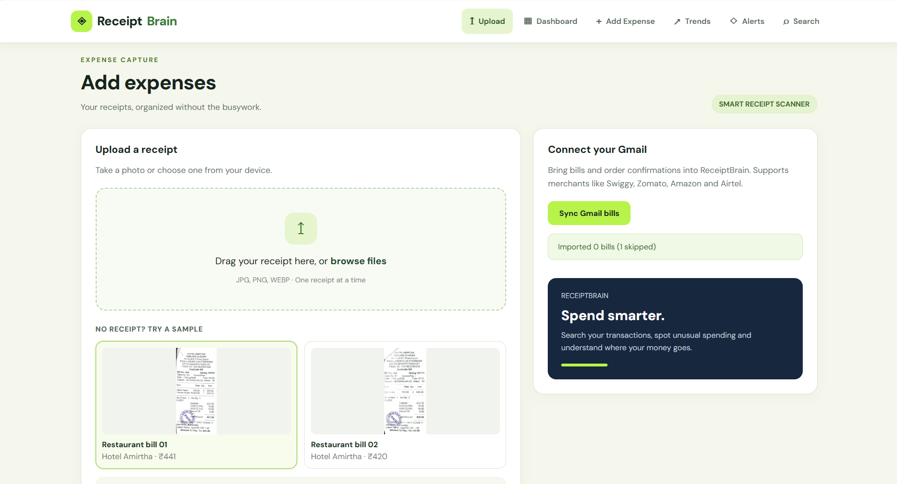

# ReceiptBrain

**AI-powered expense intelligence with multimodal receipt extraction, CrewAI agents, and semantic search.**

ReceiptBrain started with a simple question: *Can AI reduce the effort of tracking expenses without compromising the accuracy of financial data?*

I built ReceiptBrain as a full-stack application that converts receipt images and bill emails into structured, searchable transactions. Beyond recording expenses, it helps users understand spending patterns, identify unusual transactions, and generate financial insights.

The application combines **Gemini, CrewAI, Groq, MiniLM, pgvector, FastAPI, React, and Supabase**.

> **Project status:** Working locally. Public deployment and production authentication are planned. The screenshots demonstrate the application using test and sample data.

## Application Preview


The dashboard provides an overview of monthly spending, transaction history, category distribution, and spending patterns.

## Key Features

### 1. AI-Powered Receipt Extraction

Upload a receipt in JPG, PNG, or WEBP format.

ReceiptBrain uses a Gemini vision model through OpenRouter to extract structured information, including:

- Merchant name and transaction date
- Total amount and expense category
- Purchased items, quantities, and prices
- Additional receipt information when available

The extracted data is validated and stored in Supabase.



### 2. CrewAI Multi-Agent Expense Intelligence

ReceiptBrain integrates **CrewAI with Groq-hosted Llama models** to support AI-assisted expense processing and interpretation.

The agent workflow is designed around four responsibilities:

| Agent responsibility | Purpose |
|---|---|
| Parsing and validation | Interpret extracted expense information and check its structure |
| Categorization | Identify the appropriate spending category |
| Anomaly analysis | Examine transactions for potentially unusual spending |
| Insight generation | Produce understandable financial observations and recommendations |

The agent-based functionality complements the deterministic financial analytics rather than replacing it.

**Design decision:** Financial calculations and structured filters remain in Python and SQL. LLMs are used for extraction, interpretation, and natural-language explanations.

This separation helps keep financial computations predictable while allowing the application to benefit from generative AI.

### 3. Spending Insights and Forecasting

ReceiptBrain analyzes historical expenses to identify spending patterns and estimate upcoming expenses.

The Trends page includes:

- Category-wise spending over time
- Month-on-month comparisons
- Spending increases and decreases
- Next-month expense estimates
- AI-generated financial observations



### 4. Semantic Expense Search

Instead of requiring users to remember exact transaction details, ReceiptBrain supports natural-language expense searches.

Example queries:

- `Swiggy expenses in 2026`
- `food delivery above 400`
- `electricity and utilities bills`
- `subscriptions and streaming`

The search system combines:

- **Sentence Transformers:** `all-MiniLM-L6-v2`
- **384-dimensional embeddings**
- **Supabase PostgreSQL with pgvector**
- **Structured filtering:** merchant, category, date, and amount

This hybrid approach combines semantic similarity with exact transaction constraints.



### 5. Spending Anomaly Detection

ReceiptBrain monitors transactions for potentially unusual spending behavior.

It can flag:

- Possible duplicate transactions
- Spending spikes compared with previous activity
- Transactions involving new merchants

Alerts provide contextual information to help users understand why a transaction was flagged.



### 6. Spending Dashboard and Analytics

The dashboard provides a consolidated view of expenses, including:

- Total spending
- Number of transactions
- Highest-spending category
- Average transaction amount
- Category-wise spending distribution
- Transaction history



### 7. Manual Expense Entry

Users can record transactions without uploading a receipt.

The form supports merchant name, amount, date, category, payment method, and optional notes.



### 8. Gmail Bill Integration

ReceiptBrain supports importing eligible bills and order confirmations through the Gmail API.

The local integration uses OAuth 2.0 with read-only Gmail permissions and tracks Gmail message IDs to avoid reimporting the same message.

Supported sender searches include services such as Swiggy, Zomato, Amazon, Airtel, and other common billing providers.

The current OAuth flow is intended for local development. A production web-based Gmail connection has not yet been implemented.



## Technology Stack

| Layer | Technologies |
|---|---|
| Frontend | React, Vite, React Router, Recharts, CSS |
| Backend | Python 3.11, FastAPI, Uvicorn |
| Database | Supabase PostgreSQL |
| Vector Search | pgvector, Sentence Transformers |
| Receipt Extraction | Gemini via OpenRouter |
| AI Agent Orchestration | CrewAI |
| Agent LLM Provider | Groq-hosted Llama models |
| Email Integration | Gmail API, OAuth 2.0 |
| Data Processing | Python, SQL, NumPy |

## System Architecture

```text
                   RECEIPTBRAIN
                        |
          +-------------+-------------+
          |             |             |
     Receipt Image  Gmail Bills   Manual Entry
          |             |             |
     Gemini Vision  Email Parser      |
          |             |             |
          +-------------+-------------+
                        |
                 FastAPI Backend
                        |
               Data Validation
                        |
                Supabase PostgreSQL
                        |
          +-------------+-------------+
          |             |             |
       MiniLM       Analytics      CrewAI
      Embeddings    & Anomalies    Agents
          |             |             |
       pgvector     Forecasting    Groq LLMs
          |             |             |
          +-------------+-------------+
                        |
                   REST APIs
                        |
                 React Frontend
                        |
          Dashboard | Search | Trends
             Alerts | Upload | Insights
```

### Data Processing Workflow

**Receipt ingestion**

1. The user uploads a receipt image.
2. The vision model extracts transaction details.
3. The backend validates and normalizes the extracted data.
4. The transaction is saved in Supabase.
5. Background processing can generate embeddings and run additional analysis.

**Semantic retrieval**

1. The user enters a natural-language query.
2. MiniLM generates an embedding for semantic comparison.
3. pgvector retrieves relevant transactions.
4. Structured constraints refine the results.
5. The frontend displays matching expenses.

**AI-assisted analysis**

CrewAI coordinates agent-based processing using Groq-hosted Llama models. Generated observations are presented alongside rule-based analytics and forecasts.

## Project Structure

```text
ReceiptBrain/
|
|-- backend/
|   |-- main.py
|   |-- ocr.py
|   |-- embeddings.py
|   |-- analytics.py
|   |-- gmail_sync.py
|   |-- agents/
|   |-- requirements.txt
|   |-- check_setup.py
|   |-- seed_demo.py
|   `-- .env.example
|
|-- frontend/
|   |-- public/
|   |   `-- samples/
|   |-- src/
|   |   |-- pages/
|   |   |-- App.jsx
|   |   `-- App.css
|   `-- package.json
|
|-- supabase/
|   `-- migrations/
|
|-- docs/
|   |-- screenshots/
|   `-- EXPLAINED.md
|
|-- README.md
`-- .gitignore
```

## Getting Started

### Prerequisites

- Python 3.11
- Node.js and npm
- Supabase project
- API credentials for the AI services you enable
- Gmail OAuth credentials (optional)

### 1. Clone the Repository

```bash
git clone https://github.com/DhanusriRS2006/ReceiptBrain.git
cd ReceiptBrain
```

### 2. Configure the Database

Create a Supabase project and run the database migration in the Supabase SQL Editor:

```text
supabase/migrations/20261101000000_receiptbrain_v2.sql
```

Ensure the database schema supports manual expense records as well as receipt uploads.

### 3. Start the Backend

Open PowerShell:

```powershell
cd backend

py -3.11 -m venv .venv

.\.venv\Scripts\Activate.ps1

pip install -r requirements.txt

Copy-Item .env.example .env
```

Configure the required environment variables in `backend/.env` using the names documented in `.env.example`.

Then run:

```powershell
python check_setup.py

uvicorn main:app --reload
```

Backend URL:

`http://127.0.0.1:8000`

Interactive API documentation:

`http://127.0.0.1:8000/docs`

### 4. Start the Frontend

Open a second terminal from the project root:

```powershell
cd frontend

npm install
```

Configure the backend URL if required:

```env
VITE_API_URL=http://127.0.0.1:8000
```

Start the development server:

```powershell
npm run dev
```

Open:

`http://localhost:5173`

### 5. Load Demo Data (Optional)

From the backend directory:

```powershell
python seed_demo.py
```

To clear the seeded sample history:

```powershell
python seed_demo.py --clear
```

The Upload page also provides two sample restaurant receipts worth ₹441 and ₹420.

**Note:** Analyzing a sample receipt currently saves it as an expense. Repeated tests may create duplicate records.

### 6. Gmail Integration (Optional)

Configure a Gmail OAuth client with read-only permissions.

Place the credentials file in:

```text
backend/gmail_credentials.json
```

Then complete the local authorization flow:

```powershell
python gmail_sync.py
```

Gmail credentials and authorization tokens must remain private and should never be committed to GitHub.

## API Endpoints

| Method | Endpoint | Description |
|---|---|---|
| POST | `/upload` | Upload and process receipt images |
| POST | `/upload-text` | Process receipt text |
| POST | `/expenses/manual` | Add a manual expense |
| GET | `/expenses` | Retrieve transactions |
| GET | `/summary` | Retrieve spending summary |
| GET | `/expenses/by-month` | Retrieve monthly spending data |
| GET | `/query?q=...` | Search expenses |
| GET | `/anomalies` | Retrieve anomaly alerts |
| GET | `/insights` | Retrieve financial insights |
| POST | `/analyze/{expense_id}` | Trigger agent-based expense analysis |
| POST | `/embeddings/backfill` | Generate missing embeddings |
| GET | `/gmail-sync` | Trigger local Gmail synchronization |

For request and response schemas, refer to the FastAPI Swagger documentation at `/docs`.

## Engineering Decisions

### Why CrewAI?

I wanted to explore how agent orchestration could organize different AI responsibilities in a financial application rather than relying on one large prompt.

CrewAI provides a structured way to coordinate model-driven tasks while keeping the backend responsible for data persistence and calculations.

### Why MiniLM and pgvector?

Traditional database filters work well when the user knows the exact merchant or date.

Semantic embeddings allow more flexible searches based on meaning, while pgvector makes similarity retrieval available within the existing PostgreSQL database.

### Why FastAPI?

FastAPI provides a straightforward Python backend for integrating AI models, asynchronous operations, database access, and REST endpoints.

### Why keep calculations outside the LLM?

Financial calculations require consistency.

ReceiptBrain uses deterministic application logic for totals, filtering, comparisons, and rule-based alerts. Language models are used where interpretation and natural-language processing are beneficial.

## Current Limitations and Future Improvements

ReceiptBrain is a functional local project, but several improvements are planned before public production use.

- **Authentication:** Add Supabase Auth and per-user access controls.
- **Database security:** Enforce row-level security and authorization on expense endpoints.
- **Receipt review:** Allow users to correct extracted information before saving.
- **Search accuracy:** Improve structured filtering and aggregation queries.
- **Background processing:** Introduce durable jobs for long-running AI tasks.
- **Testing:** Add automated tests for extraction, ingestion, search, and API behavior.
- **Deployment:** Evaluate backend hosting requirements for CrewAI and Sentence Transformers.
- **Gmail OAuth:** Implement a secure web-based authorization flow.

## Technical Documentation

I documented the implementation decisions, challenges, debugging process, and architecture in:

[EXPLAINED.md — Technical Documentation](docs/EXPLAINED.md)

## Security Notice

ReceiptBrain is an educational and portfolio project, not a production-ready financial service.

The current backend should not be exposed publicly with personal financial data until authentication, authorization, database access controls, and API protections are implemented.

Use synthetic transactions for demonstrations.

---

**ReceiptBrain — Turning everyday expenses into useful financial insights.**
